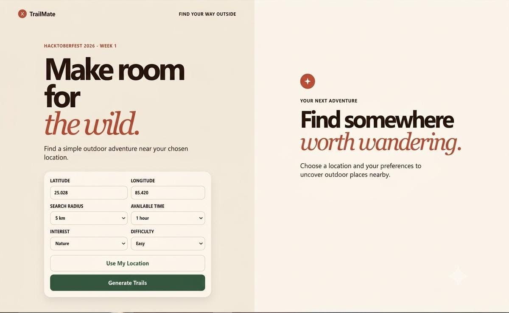
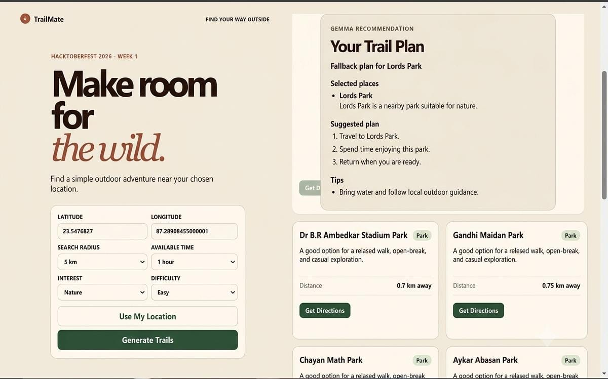

# 🌿 TrailMate — Make Room for the Wild

**Discover nearby outdoor places. Find your next little adventure. Touch grass.**

TrailMate is an AI-powered outdoor adventure planner that helps people discover nearby parks, nature spots, viewpoints, and trails based on their location, available time, interests, and preferred difficulty.

Powered by **Gemma, an open-weight AI model**, and real-world place data from **OpenStreetMap**, TrailMate transforms nearby places into personalized outdoor activity plans.

> Built for the [Hacktoberfest 2026 Open-Source AI Challenge — Week 1](https://hacktoberfest.com/) theme: **Touch Grass** 🌱

---

## 📸 Preview

<!-- Add your screenshots to a screenshots/ folder and update these paths. -->




*Discover outdoor places around you.*



*Get a personalized outdoor plan powered by Gemma.*

---

## ✨ Features

- 📍 **Location-based discovery** — Enter coordinates or use your current location.
- 🗺️ **Real-world place data** — Discover nearby outdoor locations using OpenStreetMap.
- 📏 **Flexible search radius** — Explore places within 1, 5, 10, 25, or 50 km.
- 🤖 **AI-powered recommendations** — Gemma creates personalized outdoor plans based on your preferences and available places.
- 🌳 **Personalized activities** — Choose your available time, interests, and difficulty level.
- 📌 **Useful place information** — View place names, types, distances, and short descriptions.
- 🧭 **Google Maps directions** — Open a selected destination in Google Maps for navigation and route estimates.
- ➕ **Load more places** — Browse results in manageable groups instead of overwhelming lists.
- 🛡️ **Recommendation validation** — AI-selected places are checked against the supplied OpenStreetMap results.
- 🔄 **Graceful fallback** — If Gemma returns an invalid recommendation, TrailMate can provide a basic plan based on a real available place.

## 🧠 How It Works

1. Choose a location and search radius.
2. Select your available time, interests, and preferred difficulty.
3. TrailMate retrieves nearby outdoor places from OpenStreetMap.
4. The backend sends the available places and your preferences to Gemma.
5. Gemma generates a personalized outdoor recommendation.
6. Explore the results, open directions, and head outside!

```text
User Preferences + Location
            │
            ▼
     React + Vite UI
            │
            ▼
    Node.js + Express API
            │
            ▼
   OpenStreetMap / Overpass
            │
            ▼
      Nearby Places
            │
            ▼
     Gemma via Ollama
            │
            ▼
 Personalized Outdoor Plan
            │
            ▼
       Go Explore! 🌿
```

## 🛠️ Tech Stack

| Technology | Purpose |
|---|---|
| React + Vite | Frontend interface |
| JavaScript + CSS | Application logic and styling |
| Node.js + Express.js | Backend and REST API |
| MongoDB Atlas + Mongoose | Database connection foundation |
| Gemma 3 (1B) | Open-weight AI recommendation engine |
| Ollama | Runs Gemma locally |
| OpenStreetMap | Outdoor place data |
| Overpass API | Queries nearby map features |
| Google Maps | External directions and navigation |

## 🌱 Why Open-Weight AI?

TrailMate uses Gemma through Ollama instead of relying on a paid, closed-model AI API.

This approach provides several advantages:

- **Local inference:** AI recommendations can be generated on your own machine without sending prompts to a third-party AI inference service.
- **More control:** The model and inference runtime can be changed as the project evolves.
- **Cost-conscious development:** No paid LLM API key is required for local inference.
- **Open innovation:** Developers can inspect the integration, experiment with models, and build on the project.

The application still requires internet access for OpenStreetMap queries and Google Maps directions. Local Gemma inference does not make the entire application offline.

## 🚀 Getting Started

### Prerequisites

Install the following:

- [Node.js](https://nodejs.org/)
- [Git](https://git-scm.com/)
- [Ollama](https://ollama.com/download)
- A MongoDB Atlas cluster and connection string
- An internet connection for OpenStreetMap requests

### 1. Clone the repository

```bash
git clone <YOUR_GITHUB_REPOSITORY_URL>
cd TrailMate
```

### 2. Install dependencies

Open a terminal in the project root.

```bash
cd server
npm install
```

Open a second terminal:

```bash
cd client
npm install
```

### 3. Configure environment variables

Create `server/.env` using the variable names from `server/.env.example`.

At minimum, configure your MongoDB connection string and backend port. If you use a custom Overpass endpoint, configure it there as well.

Example:

```env
MONGODB_URI=your_mongodb_atlas_connection_string
PORT=5000
OVERPASS_API_URL=https://overpass-api.de/api/interpreter
```

Use your own valid MongoDB Atlas URI. Never commit `.env` or expose database credentials in the frontend.

### 4. Download the Gemma model

Install Ollama, then run:

```bash
ollama pull gemma3:1b
```

Verify that the model is available:

```bash
ollama run gemma3:1b
```

Exit the interactive session when finished. Keep the Ollama service running while using TrailMate.

### 5. Start the backend

From the `server` directory:

```bash
npm run dev
```

The backend should be available at:

`http://localhost:5000`

### 6. Start the frontend

From the `client` directory:

```bash
npm run dev
```

Open the local URL printed by Vite in your terminal.

## 🔐 Privacy and Limitations

- Browser geolocation requires user permission.
- Location coordinates are sent to the backend when the user requests nearby places.
- Local Gemma inference keeps AI prompts on the local machine, but the external map service receives requests containing the search location.
- Nearby-place availability depends on OpenStreetMap data and public Overpass service availability.
- AI-generated suggestions may be imperfect. Verify routes, accessibility, opening hours, weather, and safety conditions before travelling.
- Google Maps calculates routes and estimated travel times after you open directions.

## 🗺️ Data Attribution

Map data © [OpenStreetMap contributors](https://www.openstreetmap.org/copyright), available under the Open Database License (ODbL).

TrailMate is an independent project and is not affiliated with OpenStreetMap, Google Maps, or Google.

## 🔮 Future Improvements

- Improve the reliability of nearby-place retrieval.
- Generate richer, preference-aware outdoor itineraries.
- Add better route and distance visualization.
- Improve recommendation quality through systematic testing of open-weight models.

## 🤝 Contributing

Contributions, bug reports, and suggestions are welcome!

1. Fork the repository.
2. Create a feature branch.
3. Make your changes and test them.
4. Open a pull request describing your contribution.

## 📄 License

Choose an open-source license before publishing the project. The license should reflect how you want others to use, modify, and distribute your code.

---

**Less scrolling. More exploring. 🌿**

*TrailMate — your next adventure might be closer than you think.*